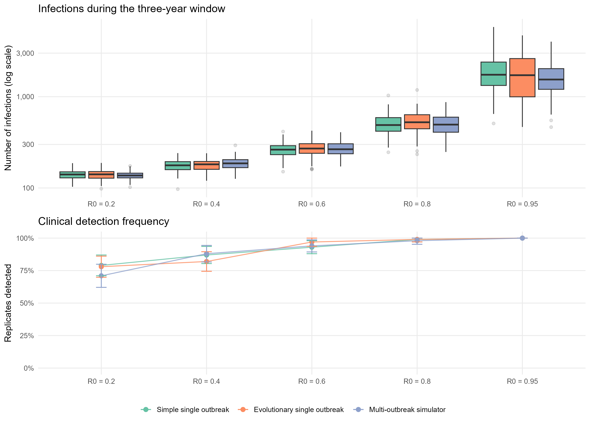

# An updated single outbreak simulator

Both single outbreak simulator functions simulate human-to-human transmission from a spillover and return a line list with infection timing and clinical outcomes. The original single outbreak simulator `sim_single_outbreak()` implements a fixed-offspring branching process and was used to produce the reuslts of the manuscript entitled "The public health value of wastewater surveillance for viruses with pandemic potential: a modelling study". The updated function `simulate_single_outbreak_evolutionary()` takes the functionality of multi-outbreak simulator `simulate_branching_process()`, meaning transmissibility can change between infection generations, susceptibles are depleted during an outbreak, and serology is also simulated.

## Main differences

| Feature | `sim_single_outbreak()` | `simulate_single_outbreak_evolutionary()` |
|---|---|---|
| Offspring mean | `mn_offspring` stays fixed during the outbreak. | Starts at `initial_mn_offspring`; mutation effects can change the mean inherited by descendants. Mutations are on by default (`prob_beneficial_mutation = 0.75`); set this to `0` for fixed transmissibility. |
| Susceptible population | Applies the initial immune proportion once to the offspring mean; it does not deplete susceptibles as infections accumulate. | Adjusts transmission for the remaining susceptible count as infections are generated within this call. `population` is a count, and `initial_immune` is an absolute count. |
| Seed cases | `index_cases` can be set to more than one. | Simulates exactly one index case per call. Call once per spillover event. |
| Simulation limit | `max_gen` limits generations and defaults to `Inf`. Set a finite value to bound a long or growing chain. | `check_final_size` limits the number of infections, including the index case; it defaults to 10,000. |
| Severity | `prob_severe` is conditional on being symptomatic. | `prob_severe` is also conditional on being symptomatic. |
| Diagnosis | Includes `prob_diagnosis` conditional on seeking healthcare and `healthcare_to_diagnosis_dist`. | Includes the same diagnosis probability and delay parameters. Diagnosed cases have `diagnosis = 1` and a `time_diagnosis`. |
| Serology | Not simulated. | Simulates seroconversion and seroreversion, with probabilities by symptom and severity class. |
| Output identifiers | Uses `id` and a textual `infector` field. | Uses `infection_id` and numeric `infection_ancestor`, and adds mutation, inherited offspring mean, serology, and outbreak fields. The output schemas are not drop-in equivalents. |

## Outbreak-size comparison

This figure shows infections during a three-year window: 100 replicates per R0 setting, with beneficial mutations disabled. The outbreak-size distributions are broadly similar, which is a useful sanity check when moving from the fixed-R0 simulator to the evolutionary one. The lower panel compares the fraction of replicates with at least one clinically detected case; whiskers show 95% binomial confidence intervals. The run used P(symptomatic) = 0.20, P(severe | symptomatic) = 0.50 in the single-outbreak functions (equivalent to absolute P(severe) = 0.10), P(healthcare sought | non-severe) = 0.10, P(healthcare sought | severe) = 0.90, and P(diagnosis | healthcare sought) = 0.10. The diagnosis draw was applied externally and consistently across all three methods.



This is an aggregate comparison, not a perfectly paired experiment: the two single-outbreak functions used the same spillover dates, while `simulate_branching_process()` generated its spillovers internally at the equivalent average rate. Susceptible depletion also differs between the functions. The figure predates the recent severity and diagnosis API update; those outcomes do not affect transmission in these models, and mutation was disabled for this run. The replicate-level results are in [replicate_detection_results.csv](inst/analysis_scripts/outbreak_simulator_comparison/replicate_detection_results.csv).

Whilst taking the functionality of the multi-outbreak simulator in terms of interdependence between generations (beneficial mutations, depletion of susceptibles), this updated function also offers the benefit of running single outbreaks or can be wrapped with spillover functions to generate multi-outbreak simulations. 

## Migrating a call

The main offspring argument changes name. Set `prob_beneficial_mutation = 0` to keep transmissibility fixed, and pass matching values explicitly because the defaults differ between functions (for example, healthcare-seeking probabilities).

```r
sim_single_outbreak(
  spillover_day = sp$t[s],
  index_case_ID = sp$ID[s],
  mn_offspring = 0.2,
  index_cases = 1
)

simulate_single_outbreak_evolutionary(
  spillover_day = sp$t[s],
  index_case_ID = sp$ID[s],
  initial_mn_offspring = 0.2,
  prob_beneficial_mutation = 0,
  population = catchment_size,
  initial_immune = 0
)
```

For repeated calls, each evolutionary call initializes its susceptible count from `population` and `initial_immune`. It does not automatically carry depletion from one spillover call to the next. Passing cumulative previous infections through `initial_immune` can approximate shared depletion when treating earlier outbreaks as already progressed; overlapping outbreaks require coordinated susceptible tracking over time which is not currently accounted for (as is the case in the original multi-outbreak simulator `simulate_branching_process`.
